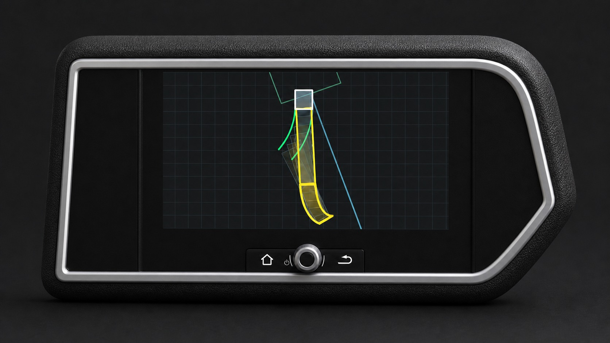

# ETS2 Reverse Posture Assistant

A world-space reverse posture and trajectory assistant for **Euro Truck Simulator 2 1.62.3.2** on Windows x64.

[Repository folder](https://github.com/yyysheng/ETS2mods/tree/main/mods/ETS2_Reverse_Posture_Assistant) | [Steam Workshop](https://steamcommunity.com/sharedfiles/filedetails/?id=3776052935) | [v1.62.3.2 release notes](RELEASE_NOTES_v1.62.3.2.md) | [Previous GitHub release v1.62.0](https://github.com/yyysheng/ETS2mods/releases/tag/reverse-posture-assistant-v1.62.0)

When reverse gear is selected, the plug-in predicts tractor and trailer posture from official
telemetry and creates collisionless frame models directly in the game world. The frames are normal
Prism3D entities, so every game camera can see the same objects. No camera feed, render pass, depth
buffer, constant buffer, or post-process overlay is read or modified.

## Features

- Live tractor reverse trajectory.
- Trailer articulation and future posture prediction.
- Separate blue tractor and orange trailer swept-area boundaries over a fixed 5 m path.
- Ground-contact-aware virtual axles for liftable and steerable tractor/trailer axles.
- Ground slope fitted from tyre contact geometry instead of suspension-sensitive
  chassis pitch and roll.
- Collisionless low-profile line entities placed on the predicted ground path.
- Automatic display only while reverse gear is selected.
- Visible through normal game rendering from exterior, interior, free, and mirror views.
- Native rendering checks the executable SHA-256, four required hook signatures, and four model-lifecycle helper signatures.
- No ReShade, `dxgi.dll`, `d3d11.dll`, or graphics API dependency.

## v1.62.3.2 update

Updates the native runtime for ETS2 1.62.3.2 Steam x64. See [release notes](RELEASE_NOTES_v1.62.3.2.md).

## Installation

### Full standalone package

1. Download the `ETS2_Reverse_Posture_Assistant_v1.62.3.2_Full.zip` release package.
2. Extract it and run `Install-Full.bat`.
3. Enable **ETS2 Reverse Posture Assistant** in the ETS2 Mod Manager.

### Steam Workshop package

1. Subscribe to the [Steam Workshop item](https://steamcommunity.com/sharedfiles/filedetails/?id=3776052935).
2. Download the `ETS2_Reverse_Posture_Assistant_v1.62.3.2_Runtime_for_Workshop.zip` release package.
3. Extract it and run `Install-Runtime-Only.bat`.

The Workshop cannot install the telemetry plug-in into the game directory, so the GitHub runtime package is required.

## Supported game version

- Euro Truck Simulator 2 1.62.3.2 Steam public, Windows x64, revision f8b10df2da6f.

## 中文说明

**欧卡 2 倒车姿态助手** v1.62.3.2 适配 Steam Windows x64 版 ETS2 1.62.3.2。原生绘制要求可执行文件哈希和所有必需签名匹配。

主要特点：

- 实时预测车头和挂车倒车轨迹。
- 蓝色车头扫掠边界与橙色挂车扫掠边界分别显示，固定预测 5 米。
- 根据车轮实际接地和转向状态适配提升桥、随动桥以及不同轴距车型。
- 坡度改由接地轮胎连线拟合，不再把前后或左右悬挂高度差误判为道路坡度。
- 使用实际前轮角、横向鞍座偏移与挂车等效轴转角进行短程铰接外推。
- 与独立 Reverse Planner 并存，不改其 DLL、Hook 或绿色引导资源。
- Reverse Planner 是独立模组；本版本只更新倒车姿态助手，规划路线是否兼容 1.62 需由其单独版本确认。
- 仅在倒挡时显示，不影响原车娱乐屏。
- 不抓取摄像头、渲染过程、深度或常量缓冲数据。
- 框线是 Prism3D 世界实体，各种正常视角看到的是同一组对象。
- 模型不含 PMC 碰撞文件，不参与车辆碰撞。
- 不安装、不替换也不删除 `dxgi.dll` 或 `d3d11.dll`。

完整安装请下载 `v1.62.3.2 Full` 包；通过 Steam 创意工坊订阅时，还需要安装 `v1.62.3.2 Runtime_for_Workshop`。

## Credits

- Project author: [yyysheng](https://github.com/yyysheng)
- Telemetry API: SCS SDK

See [THIRD_PARTY_NOTICES.md](THIRD_PARTY_NOTICES.md) for license details.

Source build instructions are available in [BUILDING.md](BUILDING.md).
